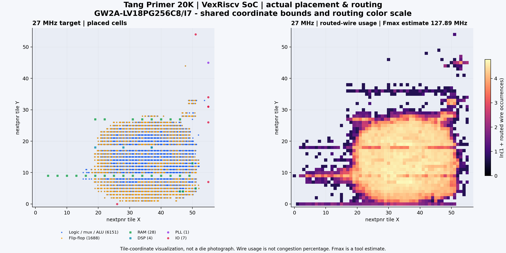
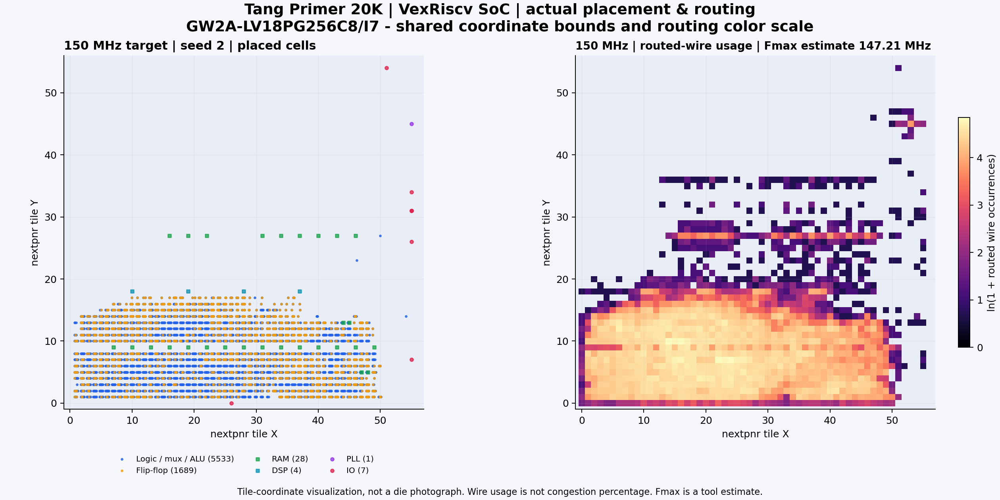
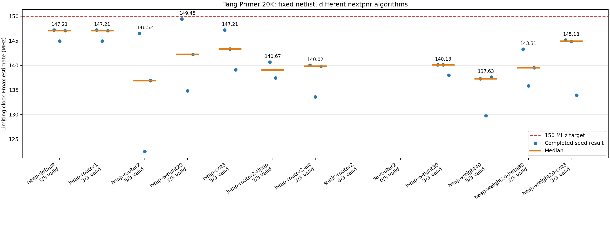
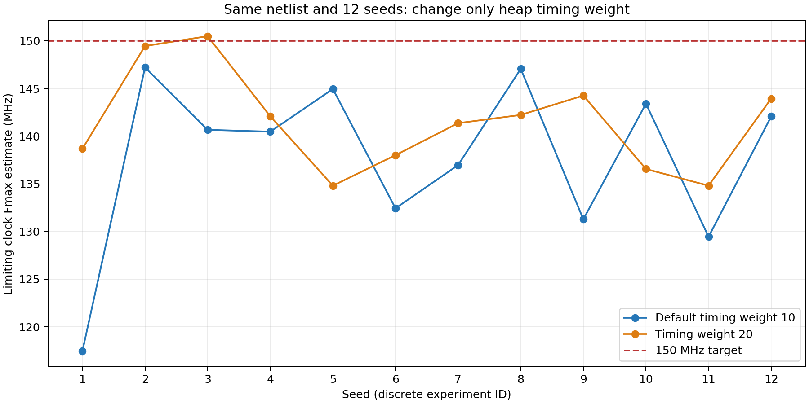
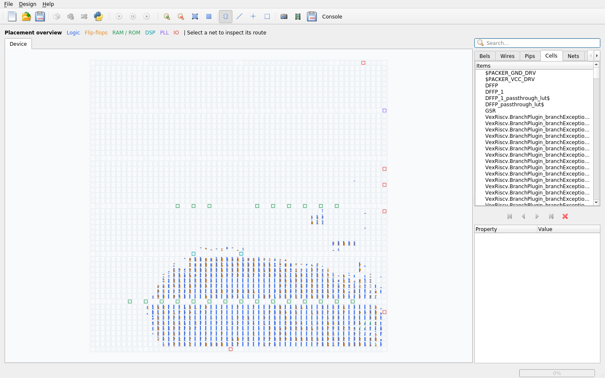
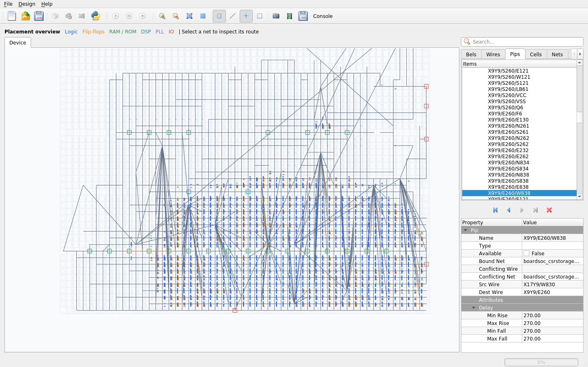

# 14：给 SoC 接上真实板子的时钟、按键、LED 和串口

前面我们在模拟器里运行 CPU：测试台产生时钟，测试台拉复位，测试台观察结果。现在换成 **Tang Primer 20K 核心板 + Dock 底板**，需要把这些工作交给真实硬件。

本章先在电脑上生成这个板子能用的电路和程序。15 章将它们构建成 `.fs` 文件，16 章再下载到板子。先记住这条主线：

```text
14：决定电路和接线          15：落实到 FPGA 资源        16：让实物运行
Python + C                 RTL → 综合 → 布局布线       .fs → 下载 → 观察
    │                             │                         │
    └─ RTL、ROM 初值、CST ────────→└─ tutorial14.fs ────────→└─ 灯和串口
```

## 阅读顺序：先全貌，再按代码追到底

本章同时包含硬件构造、软件接口、交叉编译和板卡接线，建议分四次读。下面四篇都围绕本章的 Tang 实现，逐段解释真实代码和现有结果，不要求先跳到其他章节补知识。

| 顺序 | 细读文档 | 读完能回答什么？ |
| --- | --- | --- |
| 1 | [Python 与硬件构造](guides/01-hardware/README.md) | `Platform`、`SoCCore`、`Signal`、CSR、PLL、复位分别生成什么？ |
| 2 | [C 驱动、启动代码与 ROM](guides/02-firmware/README.md) | 访问函数如何知道地址？为什么要忙等？链接脚本和 `_start` 做了什么？ |
| 3 | [生成结果逐项解读](guides/03-results/README.md) | `csr.h`、ELF、初值、Verilog、CST、manifest、各个 PASS 怎样对应？ |
| 4 | [跟踪一次按钮操作](guides/04-walkthrough/README.md) | 从按键引脚到 C 读取、LED 写入，怎样一路定位到实际电路？ |

本 README 保留总览与运行入口。想看当前默认产物，可直接打开 [27 MHz Tang 结果说明](../../results/14-tang20k/README.md)。

### 本章有哪些代码？应该先打开哪个？

| 文件 | 来源和职责 |
| --- | --- |
| `tang_run.py` | 教程运行器：两遍构造、固件编译、约束审核、RTL 收集与检查 |
| `tang_config.py` | 教程配置：区分板上 27 MHz 输入事实与可调系统/软件参数 |
| `tang_soc.py` | 教程 Tang target：调用原生 LiteX，连接 CRG、CPU、存储、UART 与 GPIO |
| `io_cores.py` | 本章的 `Heartbeat`、`LEDOutput`、`ButtonInput` 电路 |
| `firmware.py` | 本章的 GCC/链接脚本/ROM 镜像构造 |
| `checks.py` | 心跳和同步器的局部仿真检查 |
| `build_utils.py` | 本章路径定位、JSON 输出和源文件哈希 |
| `main_tang.c` | CPU 执行的裸机应用：UART 输出、按钮轮询、LED 控制 |
| `startup.S` | CPU 最先执行的入口：设置栈、初始化数据区、进入 C |
| `tang_tb.sv` / `sim_tang.py` | 默认 27 MHz 的完整数字仿真激励、UART 解码与运行器 |
| `gowin_primitives.v` / `gowin_sim_primitives.v` | 展开/仿真所需原语文件；两种用途不要混用 |

`SoCCore`、`Builder`、`CSRStorage`、`CSRStatus`、`GW2APLL` 来自 LiteX；`Signal`、`Module`、`MultiReg` 等来自 Migen；Tang `Platform` 来自 LiteX-Boards。`BoardSoC`、`firmware()`、`audit_cst()` 等是我们本章的实现。

第 14 章只维护 Tang 板卡。**运行入口是 `tang_run.py`；配置在 `tang_config.py`，电路入口在 `tang_soc.py`，应用在 `main_tang.c`。** 辅助逻辑按职责放在本章独立文件中。

## 文件之间的关系：从源码到结果

跨章节的 Builder 导出、固件编译、仿真器和 FPGA 文件分类，见 [文件生成逻辑说明](../../docs/generated-files/README.md)。下面继续按本章真实入口解释每一条文件依赖。

先分清三个位置：`chapters/14-fpga-platform` 是我们写的源码；`results/14-tang20k` 是生成和检查后的结果；第 15 章的结果才包含完成布局布线的电路和 `.fs`。

### A. 本章的源码如何调用？

```text
你执行 tang_run.py
        │
        ├─ tang_config.py：Config → 校验参数 → cfg
        │
        ├─ tutorial_paths.py：找到本地 LiteX
        │
        ├─ generate(result, cfg, words)
        │        │
        │        ├─ tang_soc.py：BoardSoC(cfg, words)
        │        │       ├─ LiteX-Boards Tang Platform：器件、资源、球位
        │        │       ├─ LiteX SoCCore：CPU、总线、ROM/RAM、UART
        │        │       ├─ 本文件 CRG：PLL、上电等待与复位
        │        │       └─ io_cores.py：心跳、LED、按钮
        │        │
        │        └─ LiteX Builder：地址图、头文件、RTL、约束、脚本
        │
        ├─ firmware.py：firmware(result, cfg, main_tang.c)
        │        ├─ 生成 linker.ld 和 test_config.h
        │        ├─ GCC 编译 startup.S + main_tang.c
        │        └─ objcopy 提取字节，返回 ROM 字数组
        │
        ├─ checks.py：check_logic()，小规模 Migen 仿真
        │
        └─ 本文件的约束审核、快照收集、Icarus 展开与报告输出
```


### B. 为什么会有两遍构造？

```text
第一遍：cfg + 临时 ROM 内容
             ↓ BoardSoC → finalize
       确定硬件地址
             ↓ Builder
       csr.h、soc.h、mem.h、csr.csv
             │
             ├───────────────────────────┐
             │                           │
             ▼                           ▼
       main_tang.c + startup.S     linker.ld + test_config.h
             └──────────┬────────────────┘
                        ↓ GCC
                   program.elf
                   program.map
                        ↓ objcopy
                   program.bin
                        ↓ 按小端每四字节组合，并在内存中补足容量
                   Python rom_words
                        │
第二遍：同一 cfg + 真实 rom_words
                        ↓ BoardSoC → Builder.build(run=False)
       更新头文件/地址图，输出真实顶层 RTL、ROM 初值和 CST
```

**头文件来自硬件定义；程序镜像来自 C/汇编；ROM 初值将程序放入硬件。** C 不会直接编译成整套 SoC RTL，Python 也不会在板上解释执行 C。

第一遍的临时 ROM 是一条原地跳转指令。第二遍覆盖同一个 Builder 输出目录，因此最后看到的 `builder/` 是交付真实固件时的结果；第一遍不是另一份要下载的 SoC。

### C. `results/14-tang20k` 中哪些文件互相依赖？

```text
Python 的硬件参数、资源连接、CSR 定义
       │
       ├─ finalize → 硬件内存/CSR 地址图
       │                  │
       │                  ├─ builder/csr.csv、csr.json
       │                  └─ builder/software/include/generated/
       │                       ├─ csr.h：寄存器地址与读写函数 ─┐
       │                       ├─ soc.h：时钟/CPU 等配置 ────┤
       │                       └─ mem.h：内存地址/容量 ──────┤
       │                                                     │
       │      startup.S + main_tang.c + linker.ld + test_config.h
       │                             │                       │
       │                             └────── GCC ←───────────┘
       │                                      │
       │                         firmware/program.elf + program.map
       │                                      │ objcopy
       │                         firmware/program.bin
       │                                      │ 转换为 rom_words
       │                                      ▼
       └──────────────────────→ 第二遍构造电路
                                              │
              CPU 数据包 VexRiscv.v ───────────┤
                                              ▼
                              builder/gateware/
                              ├─ tutorial14.v：顶层与存储描述
                              ├─ tutorial14_rom.init：程序初值
                              ├─ 其他 .init：RAM/标识存储的初值
                              ├─ tutorial14.cst：引脚、电平
                              └─ build_tutorial14.sh：工具构建命令
                                              │
                              tang_run.py 收集、审核、复制
                                              ▼
                              rtl/ 与 constraints/
                              manifest.json、summary.json、REPORT.md
```

`program.bin` 文件本身是 objcopy 输出的原始镜像；本章在 Python 内存里补齐到 ROM 容量再转成字数组，并没有把这个文件改成完整容量的填充文件。

### D. 每个关键文件是谁生成的？

| 文件 | 生产者 | 主要输入 | 后面谁使用它？ |
| --- | --- | --- | --- |
| `generated/csr.h` | LiteX Builder → export | 已分配地址的 CSR 定义 | GCC 编译 C 的访问函数 |
| `generated/soc.h` | LiteX Builder | SoC 配置与常量 | 软件头文件和 C 配置引用 |
| `generated/mem.h` | LiteX Builder | 内存区域定义 | 软件可用的地址/容量宏；实际链接布局本章另生成 |
| `builder/csr.csv` | LiteX Builder | CSR 与内存地址图 | 本章运行器审核，读者核对地址 |
| `firmware/linker.ld` | 本章 `firmware()` | ROM/RAM 地址、大小、栈预算 | 链接器决定区段和符号位置 |
| `firmware/test_config.h` | 本章 `firmware()` | `led_count` | C 编译时得到 `LED_MASK` |
| `firmware/program.elf` | RISC-V GCC/链接器 | C、汇编、头文件、链接脚本 | objcopy、反汇编与调试工具 |
| `firmware/program.map` | 链接器 | 同一次链接 | 解释函数、区段、栈符号实际位置 |
| `firmware/program.bin` | objcopy | ELF 的可加载内容 | Python 转 ROM 字数组 |
| `gateware/tutorial14.v` | LiteX/Migen 生成器 | 第二遍 SoC 电路对象 | HDL 工具与 FPGA 综合 |
| `gateware/*.init` | Memory 初值导出 | ROM 字数组及其他存储初始化 | 顶层 `$readmemh`、综合/仿真 |
| `gateware/tutorial14.cst` | 原生 Tang Platform/工具链 | 请求的资源、球位和 IO 标准 | 本章审核、nextpnr 布局布线 |
| `rtl/VexRiscv.v` | 数据包提供，本章收集 | CPU 类型和 variant 对应文件 | 补齐顶层实例引用的核心实现 |
| `rtl/sources.json` | 本章收集器 | 实际使用的全部源文件 | 下一章追溯来源、核对快照哈希 |
| `manifest.json` | 本章运行器 | 配置、PLL、引脚、固件/源哈希 | 下一章确认这一套输入的身份 |
| `summary.json` | 本章运行器 | 审核、展开和局部仿真结果 | 了解本生成步骤实际检查了什么 |
| `digital-summary.json` | `sim_tang.py` | 完整数字仿真的输出 | 证明默认配置的 CPU/UART/按键/复位测试 |

这些文件是一次生成的配套结果。修改硬件配置时应从入口重新生成，不宜手改 `csr.h` 后继续使用旧 RTL。

### E. 为什么既有 `builder/gateware`，又有 `rtl`？

`builder/gateware` 是 LiteX 的原始输出目录；`rtl` 是本教程整理的完整快照。两者有相同顶层/初值内容，但快照还加入 CPU 数据包文件、原语、仿真测试台、许可证和来源清单，让读者不必到安装目录里找缺失的模块。

同理，`constraints/tutorial14.cst` 是从 `builder/gateware` 复制的约束。它不是第二个人手写的一份独立接线方案。

`rtl/files.f` 用于原语展开，`rtl/files_sim.f` 用于数字仿真；后者使用理想 PLL 模型。下一章综合则按源清单选电路文件，并使用工具自己的器件原语支持。文件放在同一目录，不等于要全部一起交给综合器。

### F. 第 14 章与布局布线结果怎样接起来？

```text
14：rtl/、初值、CST、manifest
             ↓
15：Yosys → netlist.json（映射后的电路连接）
             ↓ nextpnr 结合器件与 CST
    routed.json（单元位置 + 使用的布线资源）
    pnr-report.json（资源和时序）
             ↓ Apicula gowin_pack
    tutorial14.fs（FPGA 配置文件）
             ↓
16：JTAG 下载 → 板上 CPU 执行 ROM 程序 → UART/LED 实物观察
```

## 默认 Tang SoC 的真实布局布线图



图片来自已有 `results/15-tang20k-build/routed.json`：左图是实际单元位置，右图按 tile 汇总真实布线资源使用量。它使用 FPGA 资源坐标，不是硅片显微照片；右图也不是每根物理导线的轨迹。

蓝色为逻辑，橙色为触发器，绿色为存储，青色为 DSP，紫色为 PLL，红色为 IO。图例按网表单元计数，不表示面积百分比或存储容量；右图颜色越亮，记录的布线资源越多，不代表时序一定更差。

[矢量版图片](images/tang20k-layout.svg)、[图片来源与重建方法](images/README.md) 同时保存在本章。第 14 章先展示最终目标长什么样，第 15 章解释这些位置和连线如何由工具确定。

### 第一轮默认参数搜索：seed 2 的实际布局布线



这张图来自 14E 保存的 `best/routed.json.gz`：150 MHz 目标、seed 2，共享系统时钟域 Fmax 估计为 **147.21 MHz**。左侧为实际单元位置，右侧为实际布线资源密度。只渲染既有结果，没有重新布局布线或下载板子。

seed 1–12 中它最好，但仍未满足 150 MHz，不能称为 150 MHz 上板通过。该结果的关键路径从核心缓存地址寄存器到 UART TX FIFO 内部寄存器使能端；`VexRiscv.clk` 是共享系统时钟网络，不只包含 CPU 内部路径。

[seed 2 矢量图](images/tang20k-layout-seed2.svg) 与输入哈希保存在 images 目录，完整试验过程见 [14E](../14e-seed-sweep/README.md)。

#### 目标频率和 Fmax 的先后关系

```text
输入：RTL/网表、引脚约束、器件、seed、目标频率 27 MHz
                          ↓
                布局器/布线器按目标优化
                          ↓
               输出：单元位置、线路、时序报告
                          ↓
               Fmax 估计值，例如 100 MHz
```

目标 27 MHz 对应约 37.04 ns 的时序预算。若结果估计可达 100 MHz，表示这份实现具有工具模型下的裕量；它不会把实际 PLL 改为 100 MHz，也不会仅因为该数值高就自动进行第二次布局。

改变目标频率会改变优化要求，可能改变结果，但不保证一定移动哪些单元。Fmax 是从最终路径时序估计出来的输出，实际运行时钟仍由 PLL 配置决定。严格比较目标频率的单独影响，应固定同一份综合网表、引脚和 seed，仅修改 nextpnr 的目标后分别运行。

进一步固定网表尝试不同 seed 的实验在 [14E：seed 搜索](../14e-seed-sweep/README.md)，它与重新生成不同系统频率的对比实验分开记录。第一轮默认参数的 seed 1–12 中，最好为 seed 2 的 147.21 MHz。后续调整 heap 时序权重已达到 150.49 MHz，完整对比见下文。这里的 Fmax 是共享系统域的静态估计。

### 最初的 150 MHz 单次尝试：seed 1 未满足目标

使用独立的 150 MHz 配置生成电路和固件，Yosys 综合通过。PLL 参数也能表示该频率，但 nextpnr 最终 CPU 路径的 Fmax 估计为 **117.47 MHz**，低于目标 150 MHz（周期约 6.67 ns）。

工具写出了 routed.json/时序报告，随后因目标失败退出；该次没有打包 bitstream 或下载板子；随后在 14E 独立进行了 seed 与算法参数实验。这次单独尝试不生成布局图片。初步放置时的 99.43 MHz 是中间值，最终应读路由后结果。

记录见 [150 MHz 实验报告](../../results/15-tang20k-build-150mhz/REPORT.md)。第 14 章软件实验上限为此扩展到 150 MHz，它只是允许尝试的参数范围，不保证能达到时序，也不表示 FPGA 的频率规格上限。

## 调整 nextpnr 后：150 MHz 静态时序通过了吗？

已经通过一项。使用原来的 **ROM 8 KiB、SRAM 4 KiB、main RAM 16 KiB** 配置，保持同一份 Yosys 综合网表，调整 nextpnr 的 heap 布局时序权重为 20，并使用 seed 3，最终 Fmax 估计达到 **150.49 MHz**。

### 这个设计已经“综合进去”了吗？

它已完成综合和布局布线。优化参数作用于 nextpnr 阶段，实验反复读取同一份已综合的电路：

```text
第 14 章：150 MHz 配置、C 固件
                     ↓ LiteX / C 编译
完整 RTL、ROM 初始化、CST
                     ↓ Yosys（已完成）
results/15-tang20k-150mhz/netlist.json
                     │ 同一份输入
        ┌────────────┴────────────────┐
        ▼                             ▼
默认 heap 时序权重 10             时序权重 20
seed 1–12                       seed 1–12
最好 147.21 MHz                 最好 150.49 MHz
                                      ↓
                results/14e-algorithms/best/
                routed.json.gz：单元位置和具体连线
                pnr-report.json：最终时序报告
                summary.json：seed 3、退出码 0、PASS
```

| 阶段 | 当前状态 |
| --- | --- |
| 150 MHz 配置的 RTL / 固件生成 | 已完成 |
| Yosys 综合 | 已完成；各算法实验复用同一综合网表 |
| nextpnr 布局布线 | 权重 20、seed 3 满足 150 MHz |
| Apicula 打包 `.fs` | 本轮未执行 |
| 下载和板上运行 | 本轮未执行 |

章节默认配置保留。此前缩小 main RAM 到 4 KiB 的实验，其最佳值为 142.35 MHz；本次 150.49 MHz 对应上面列出的 16 KiB 配置。

### 同样的电路，换参数能改善多少？

先比较 13 组配置，每组使用相同的 seed 2、5、8：



蓝点是每个完成的 seed 的 Fmax，橙线是该组中位数，红线是 150 MHz 目标。没有完整结果的组标为 No timing result。图中权重 20 的最好值是 149.45 MHz，因此进一步扩大了它的 seed 范围。

再用相同的 seed 1–12 比较默认权重 10 和权重 20：



| 指标 | 默认权重 10 | 权重 20 |
| --- | ---: | ---: |
| 最佳 Fmax | 147.21 MHz | 150.49 MHz |
| 中位数 | 140.57 MHz | 141.72 MHz |
| 150 MHz 通过 | 0/12 | 1/12 |

共有 48 次实际尝试，41 次产生完整时序结果，7 次工具错误，没有超时。当前 Gowin 后端拒绝 static；sa 在初始布局阶段崩溃；实验性拆线重布有一项触发断言。router2 和更大的时序权重没有超过权重 20 的最佳结果。完整参数、日志及错误原因见 [14E 实验记录](../../results/14e-algorithms/README.md)。

最佳实现的关键路径约 6.645 ns；150 MHz 周期为 6.667 ns，余量约 0.022 ns。它是当前工具与器件模型下的静态结果，板上表现还需要实际验证。

## nextpnr 的原理：把已有电路放进 FPGA 的已有资源

可以把综合网表理解成一张“元件和连接清单”：有哪些 LUT、触发器、RAM 和 PLL，以及谁连到谁。nextpnr 还读取芯片数据库和引脚约束，决定这些元件在芯片上使用哪个位置、每条连接使用哪些线路和开关。[官方项目说明](https://github.com/YosysHQ/nextpnr)

```text
输入三件东西：
  网表：需要哪些元件，元件之间如何连接
  芯片数据库：有哪些合法位置、线路、开关和延迟
  约束：器件型号、固定引脚、目标时钟
                         ↓
  Pack       整理成 FPGA 资源能容纳的单元组合
                         ↓
  Place      给每个单元选一个合法位置
                         ↓
  Route      给每条连接选择线路和可编程开关
                         ↓
  Timing     根据实际元件、位置和线路检查路径延迟
                         ↓
  routed.json + pnr-report.json
```

### Pack：哪些单元可以组合在一起？

FPGA 的资源有自己的结构和共享规则。例如，LUT 与触发器可能使用相邻的资源，RAM 有限定的端口/模式，时钟也有专门的连接资源。packing 阶段整理映射后的电路，使后续放置满足所选 FPGA 后端的结构规则。具体组合方式由器件决定。

### Place：元件应该放在哪里？

布局要同时考虑合法位置、连线长度、资源拥挤和时序。相互连接的单元放近一些，通常更容易获得短连线；但附近的位置可能已经被占用，或者根本没有所需 RAM。

```text
源寄存器 A → LUT → LUT → 目标寄存器 B

方案甲：A、两个 LUT、B 相距较近
方案乙：B 被放到更远的位置

电路功能相同，连接需要走的距离可能不同。
```

FPGA 的行列和 RAM/PLL 位置已经制造好了。nextpnr 在这些位置中选择；我们不能通过参数把 RAM 的固定行移到芯片中央。它的架构接口描述可放置位置、线路、开关，以及位置是否合法。[架构接口说明](https://github.com/YosysHQ/nextpnr/blob/main/docs/archapi.md)

我们使用的 heap 是解析布局算法，会根据连接和优化目标寻找位置，再调整到合法资源上。`--placer-heap-timingweight` 改变它对时序的重视程度：权重 20 会改变优化取舍，但数值更大并不保证布局更好。

### Route：已经放好的元件，怎样真正连起来？

布局完成后，FPGA 中两点之间仍可能有多条路线。布线器在芯片已有的连线网络中搜索，并处理不同信号争抢资源的情况。

```text
A 输出 ── 线段 ── 开关 ── 线段 ── 开关 ── B 输入
                 ↑                    ↑
          最终由 FPGA 配置位控制连接
```

近的位置也可能需要绕路；一条路径用掉资源后，其他路径可能改走别处。router1、router2 的搜索和冲突处理策略不同。实验性的 rip-up 会拆掉部分线路再尝试连接。本次 router2 的完成日志会报告 overused / overuse；结束时应没有资源冲突。

### Timing：为什么最终频率可能与目标不同？

以寄存器到寄存器的建立时间检查为例，一周期需要容纳：

```text
时钟到源寄存器输出的延迟
 + 组合逻辑延迟
 + 布线延迟
 + 目标寄存器建立时间
 ≤ 时钟周期预算（还需按约束处理时钟关系等因素）
```

实际时序分析还会处理时钟关系及其他路径类型。优化时，布局/布线阶段会参考时序估计；布线完成后，工具根据选定路线给出最终报告。`--freq 150` 提供优化目标和预算，PLL 配置决定实际工作时钟。

seed 改变搜索中的选择，因此同一份电路也能得到不同结果。本轮权重 20 的 seed 3 达到 150.49 MHz，而其他 seed 大多未满足 150 MHz。图中的折线只连接离散实验点，seed 编号大小不表示布局质量高低。

## 用 nextpnr GUI 交互查看布局布线

可以。我们的 WSL 有 WSLg，已经成功打开并加载最佳布线结果。原 OSS CAD Suite 在恢复 Gowin 快照时存在缓存初始化错误，本仓库增加了独立的查看版本；用于频率实验的工具保留。GUI 可查看单元、位置及连接，打开已有结果无需重新综合或重新布线。

在 tutorial 根目录执行（查看版本首次使用时先构建）：

```bash
python chapters/14e-seed-sweep/build_gui_viewer.py
python chapters/14e-seed-sweep/view_gui.py
```

这个入口先核对 `best/routed.json.gz` 的哈希，将它解压为同目录的 `routed.json`，再启动独立查看版本。RTL 顶层叫 `tutorial14`，保存的路由 JSON 顶层叫 `top`；入口从 JSON 读取顶层名，并显式指定同一份 GW2A-18C 芯片数据库。默认查看的是 **时序权重 20、seed 3、Fmax 150.49 MHz** 的结果。

```text
routed.json.gz
     ↓ 解压、核对身份
routed.json：已有位置和线路
     ↓ nextpnr --gui --json ...
交互窗口：浏览、缩放、搜索单元和连接
```

它使用 `--no-pack --no-place --no-route`，没有调用重新实现的流程。GUI 的处理按钮仍可用于新实验；查看这份冻结结果时，直接浏览即可。若要重放旧 seed 2 的结果：

```bash
python chapters/14e-seed-sweep/view_gui.py \
  --input results/14e/best/routed.json.gz
```

### 刚才的 array2d 越界是什么问题？

报错发生在 `attributesToArchInfo()` 恢复单元位置时。Gowin 的 `notifyBelChange()` 访问布局缓存 `fast_logic_cell`，但该缓存原本在 `prePlace()` 中初始化。直接读取已经布线的 JSON 会跳过布局阶段，于是缓存宽度仍为 0，触发 `x >= 0 && x < m_width` 的断言。

查看版本在这类恢复流程中跳过尚未初始化的布局缓存回调，通用层仍恢复实际 BEL 绑定和路由。另补充 Qt5 构建支持，以使用当前系统的库。源码版本固定为 `861c57be9c9a0c38ab60b0eabd19903db37efa22`，补丁保存在本仓库。它用于浏览已有结果；新频率实验继续使用原 OSS CAD Suite。

已经让修复版实际读取快照再导出，并逐项比较：**7293 个单元位置、8082 条非空路由网络、58372 个路由资源三元组全部一致**。原始快照和 150.49 MHz 时序报告保持原样。构建和恢复验证证据见 [GUI 修复记录](../../results/14e-gui/README.md)。

### 为什么原 GUI 没有概览图清楚？

原 GUI 默认同时显示 BEL、wire、PIP 等底层资源，包含很多未使用的资源框架；已用单元主要以白色表示。我们的科学绘图只画使用到的单元，并按类型着色，右侧还把线路使用量汇总成密度，所以更适合先看全局。

另外，当前 Gowin 后端的原绘图函数只给 LUT、ALU、触发器和分布式 RAM 定义图形。块 RAM、DSP、PLL、IO 虽然有位置数据，界面却没有给它们画符号。查看版本已补充这些常用资源的示意标记。



[原界面截图](../../results/14e-gui/gui-before.png) 可用于对照。当前默认视图做了这些调整：

- 浅色背景，弱化网格和未使用资源；按类型给已用单元着色。
- 蓝色逻辑、橙色触发器、绿色存储、青色 DSP、紫色 PLL、红色 IO；顶部保留图例。
- 默认只显示 BEL 单元；wire / PIP / group 细节按需开启，选中网络仍能高亮其路由。
- 默认进入 Cells 标签，便于用 main_ram、rom、VexRiscv 等设计名称搜索。
- 控制台默认收起，工具栏 Console 可切换显示；芯片视图按窗口比例适配。

资源符号使用实际 tile 位置；符号大小用于辨认类型，不表示真实宏面积或 RAM 容量。绿色同时包括 ROM、SRAM、main RAM 和 CPU 内部存储。分类颜色使用 GUI 的高亮层，手动修改高亮组后可重新打开快照恢复默认分类。

### 单独打开 120 MHz，并显示 Nets

```bash
python chapters/14e-seed-sweep/view_gui.py \
  --input results/15-tang20k-build-120mhz/routed.json \
  --show-nets --title "Tang Primer 20K - 120 MHz - Nets"
```

`--show-nets` 默认切到 Nets 标签，并显示已使用 PIP 的连接示意。线段连接路由资源的代表 tile 位置，用于观察连接关系；它没有表达每条金属轨道的真实形状。选中单个网络可突出显示该网络，减少全局连线的干扰。



截图读取已有的 120 MHz 结果，未重新布局布线或下载到 FPGA。

### 建议先看什么？

1. 用滚轮缩放；右键拖动或中键拖动平移，Shift + 左键拖动也可平移。
2. 在设计浏览器的 Cells 标签中搜索 `main_ram`，回车选择匹配项，观察存储单元的所在位置。
3. 搜索 `ways_0_tags`，找到指令缓存 tag RAM；它与本轮最佳关键路径的终点有关。
4. 在 Nets 标签中搜索连接名，选择网络查看其高亮线路。结合 `pnr-report.json` 中的源/目标单元和端口读关键路径。

界面中的 BEL 是可放置元件的位置，wire 是连线资源，PIP 是可编程连接点。网表里的 `NEXTPNR_BEL`、`ROUTING` 属性记录了实际使用的位置和线路；GUI 读取的是这些实现信息。界面呈现的细节取决于 Gowin 后端提供的绘图信息，静态时序的精确数值仍以最终报告为准。[架构接口](https://github.com/YosysHQ/nextpnr/blob/main/docs/archapi.md)、[GUI 操作实现](https://github.com/YosysHQ/nextpnr/blob/main/gui/fpgaviewwidget.cc)。

这与上面的科学绘图互补：GUI 适合交互追踪某个单元或网络；README 的对比图适合同时比较多次实验的 Fmax。

## 1. 我们究竟往板子上放了什么？

板上焊着一颗高云 FPGA，型号为 `GW2A-LV18PG256C8/I7`。它内部有可配置逻辑、触发器、块存储器和连线。构建工具使用这些资源，搭出我们的 VexRiscv CPU、总线、存储器和外设。

**下载后，CPU 是 FPGA 内部的一套真实电路。** C 程序由这个 CPU 执行；Python 在电脑上运行，用来描述和生成电路。

```text
Tang Primer 20K 核心板 + Dock

27 MHz 时钟源 ───────┐
                    ▼
             ┌────────────── FPGA ──────────────────┐
复位按钮 ───→│ CRG：PLL 与复位 → sys 时钟             │
             │                         │             │
             │                   VexRiscv CPU        │
             │                         │             │
             │                      Wishbone         │
             │             ┌───────────┼──────┐      │
             │             ▼           ▼      ▼      │
             │            ROM         RAM   CSR 桥   │
             │          启动程序      数据/栈   │      │
             │                           UART/GPIO   │
             │                             │         │
             │ sys → 心跳计数器 ────────────┼────┐    │
             └─────────────────────────────┼────┼────┘
                                           │    ▼
                      USB-UART ←→ UART 引脚│  心跳 LED
                                           └─ CPU LED / 用户按键
```

第一版使用 FPGA 内部的存储资源。板上的 DDR3 和 Flash 此时没有接入 CPU 的运行路径。

## 2. Platform、SoC、CRG 各负责哪件事？

可以把它们理解为三个问题：**手里有什么板？要搭什么电路？电路从哪里获得时钟和复位？**

| 代码对象 | 回答的问题 | 本章的具体内容 |
|---|---|---|
| `Platform` | FPGA 是哪个型号，信号接哪个脚？ | Tang 标准 Dock 的器件、封装、时钟/串口/LED 等引脚 |
| `BoardSoC` / `SoCCore` | FPGA 内部放哪些模块，怎么互连？ | VexRiscv、Wishbone、ROM/RAM、UART 和 GPIO |
| `CRG` | 怎么产生系统时钟，什么时候释放复位？ | 27 MHz 输入、rPLL、上电等待、复位同步器 |
| `Builder` | 怎样把这些描述输出成构建输入？ | Verilog、存储初值、软件头文件、地址表及平台约束 |

### `platform.request()` 怎么和一根真实的线联系起来？

本章有这两行：

```python
heartbeat = Signal()
self.comb += platform.request('led', 4).eq(~heartbeat)
```

`Signal()` 创建一个硬件信号；`platform.request('led', 4)` 取得平台定义中的第 4 号 LED 连接；`.eq(~heartbeat)` 描述这根输出线要接到心跳信号的反相。

```text
heartbeat 信号
    │ 反相：本板 LED 低电平点亮
    ▼
顶层输出 led4
    │ CST 指定 A13
    ▼
FPGA 封装 A13 球位
    │ 电路板已经焊好的连线
    ▼
LED
```

这不是 Python 每隔一秒执行一次赋值。Python 生成电路后就结束了；FPGA 上的计数器一直运行。

### `SoCCore(...)` 的参数具体改变什么？

本章核心配置摘录如下：

```python
cpu_type='vexriscv', cpu_variant='standard', cpu_reset_address=0,
integrated_rom_size=cfg.rom_size, integrated_rom_init=rom_words,
integrated_sram_size=cfg.sram_size,
integrated_main_ram_size=cfg.main_ram_size,
with_uart=True, uart_name='serial', uart_baudrate=cfg.baud,
with_timer=False, with_ctrl=False
```

- `cpu_type` 选择 CPU 集成，`cpu_variant` 选择这个 CPU 的配置。
- `cpu_reset_address=0` 让 CPU 集成把复位入口配置为地址 0；ROM 也映射在这里，入口处放 `_start`。
- 三个 `integrated_*_size` 指定要生成的片内存储容量，单位为**字节**。
- `integrated_rom_init` 提供 ROM 的初始内容，也就是编译后的启动程序。
- UART 参数创建串口外设，并使用平台的 `serial` 引脚，选择对应波特率。
- 本章没有启用 Timer 或软件控制器；复位使用板上按键与 CRG。

`clk_freq=cfg.sys_clk_hz` 告诉 LiteX 系统时钟是多少，供 UART 等模块计算参数；实际生成这个时钟的是 CRG 中的 PLL。两边必须一致。

### UART 在 FPGA 里面，还是在 Dock 上？

**两边都有电路，任务不同。** LiteX 在 FPGA 内生成 UART 控制器：发送时把字节转成串行位，接收时把串行位还原成字节。Dock 板上的 USB 桥把这条串口接到电脑，电脑才会出现 `/dev/ttyUSB*`。

```text
FPGA 内部                         Dock 板                  电脑
CPU → CSR → LiteX UART TX → M11 → USB 桥的串口接收端 → USB → 串口终端
CPU ← CSR ← LiteX UART RX ← T13 ← USB 桥的串口发送端 ← USB ← 串口终端
```

这里 TX/RX 按 FPGA 的方向命名。M11、T13 是当前 Tang 平台的连线约束。

`with_uart=True` 创建 FPGA 内部的 UART；`uart_name='serial'` 让 LiteX 请求平台中名为 `serial` 的引脚；CST 再把它们绑定到 M11、T13。`uart_baudrate=cfg.baud` 设置 FPGA UART 的波特率，本章默认 115200，电脑串口也要匹配。

所以 UART 的收发逻辑是片内实现的，**通过 USB 看日志仍依赖 Dock 的桥接电路和板上连线**。JTAG 下载与 UART 日志使用同一个 USB 设备的不同接口；CPU 写 UART 寄存器不会经过 JTAG。


## 3. CPU 怎样让灯亮，按键怎样被 CPU 读到？

我们留两条不同的 LED 路径，便于观察系统运行到哪一步。

```text
硬件心跳：sys 时钟 → 计数器 → heartbeat → led4

CPU 控灯：C 调用 leds_output_write()
             → CPU 执行 store
             → Wishbone → CSR 桥 → leds.output 寄存器
             → 输出线 → led5

读取按键：按键管脚 → 两级同步器 → buttons.input 状态
             → CSR 桥 → Wishbone → CPU 执行 load
             → C 得到 buttons_input_read() 的返回值
```

`leds_output_write()` 和 `buttons_input_read()` 是生成头文件里的寄存器访问函数。前者写硬件地址，后者读硬件地址；它们让 C 程序能使用 FPGA 中的外设。

本章用户按键是低有效：按下时引脚变为 0。硬件先反相，所以软件读到 1 表示按下。LED 也低有效：内部逻辑的 1 经过反相，输出为 0，灯亮。

按键与系统时钟没有固定关系，因此经过两级同步器再供 CPU 读取。同步器减少亚稳态传播，**机械抖动仍可能让一次按压产生多次电平变化**；本章只读取按下/松开的状态。

## 4. 时钟和复位：为什么下载后 CPU 才能开始？

CPU 每个时钟边沿推进内部状态。板上的时钟源提供 27 MHz 输入，本章默认也选择 27 MHz 系统频率，经过 rPLL 送入 `sys` 域。

```text
下载完成
    │
    ├─ POR 计数器在 27 MHz 输入时钟下倒计数
    │     默认 65,536 拍，约 2.43 ms
    ▼
解除 PLL 复位 → PLL 输出系统时钟 → LOCK 有效
    ▼
系统复位同步释放
    ▼
CPU 的 PC 从 0 开始 → ROM 中的 _start → main()
```

为什么先等一等？重新配置 FPGA 后，各模块需要从确定的初始状态启动；CPU 也要等系统时钟可用。按下复位键会重新进入这条复位流程。

```python
pll.register_clkin(clk, cfg.reference_clk_hz)
pll.create_clkout(self.cd_sys, cfg.sys_clk_hz, margin=0, with_reset=False)
```

第一句声明输入频率，第二句要求输出频率。本章另外显式连接复位同步器，让 PLL 复位或尚未锁定时保持系统复位。

- **27 MHz 输入**是这块板的硬件条件。
- **系统频率**是设计参数，可通过 `--sys-clk-hz` 改变。
- **65,536 拍等待**是本教程选值，可通过 `--por-cycles` 改变。
- PLL 的倍频/分频值由工具求解，实际结果见 `manifest.json` 的 `pll`。

改系统频率要重新生成电路和固件，再重新综合、布局布线。电脑端改一个数字，已经下载的 FPGA 不会随之改变。

## 5. C 程序怎样进入 ROM？为什么要生成两遍 SoC？

电路和程序互相需要信息：C 程序需要知道 UART、LED 的地址，电路的 ROM 又需要放入编译后的程序。

`tang_run.py` 按下面的顺序解决：

```text
第一次构造 SoC
    └─ 确定地址图 → 生成 csr.h / soc.h 等头文件
                              │
startup.S + main_tang.c + 链接脚本
                              │ GCC 编译、objcopy 转换
                              ▼
                         ROM 初始化字
                              │
第二次构造 SoC ←───────────────┘
    └─ ROM 带上真实程序 → 输出完整 RTL 和 .init 文件
```

第一遍只为取得地址与头文件；最终交给 15 章的是第二遍带真实固件的结果。

启动代码设置 SP、搬运有初值的 `.data`、清零 `.bss`，随后进入 `main()`。默认主 RAM 从 `0x40000000` 开始，大小 16 KiB；初始 SP 为末端 `0x40004000`，栈向低地址分配。链接脚本预留 1024 字节栈预算，并检查数据与栈是否重叠。

固件进入 `main()` 后打印 `HELLO`，循环读取按键、更新 CPU LED，每一百万次循环打印 `ALIVE`。这一百万是软件计数阈值，打印间隔随 CPU 频率和执行路径变化。

### ROM、SRAM、main RAM 为什么列成三个区域？

CPU 通过地址区分它们：

| 区域 | 默认起始字节地址 | 本章容量 | 用途 |
|---|---|---|---|
| ROM | `0x00000000` | 8 KiB | 启动代码和程序 |
| SRAM | `0x10000000` | 4 KiB | LiteX 的片内 SRAM 区域 |
| main RAM | `0x40000000` | 16 KiB | 本章链接脚本放置 `.data/.bss` 和栈 |
| CSR | `0xf0000000` | 64 KiB 地址窗口 | UART、LED、按键等寄存器的访问区域 |

CSR 的 64 KiB 是地址空间窗口，不能理解成给外设分配了一块 64 KiB RAM。SRAM 与 main RAM 都是本章生成的片内存储，名字与基地址用于区分区域；本章固件的数据和栈实际放在 main RAM。

## 6. CST：告诉工具信号接哪个 FPGA 引脚

CPU 内部的总线大多不离开 FPGA。真正接到板上器件的信号，需要顶层端口和物理引脚约束。

```text
CPU 寄存器地址：决定 CPU 访问哪个外设
FPGA 封装球位：决定外设信号从哪个物理脚出去
```

本章 CST 中的例子：

```text
IO_LOC "led4" A13;
IO_PORT "led4" IO_TYPE=LVCMOS33;
```

第一句将顶层 `led4` 放到 A13；第二句指定对应 IO 标准。CST 由 LiteX 的平台连接信息生成，脚本再用独立的管脚记录核对它。

| 顶层端口 | 球位 | IO 标准 | 本章用途 |
|---|---|---|---|
| `clk27` | H11 | LVCMOS33 | 27 MHz 输入 |
| `serial_rx` | T13 | LVCMOS33 | 电脑发数据，FPGA 接收 |
| `serial_tx` | M11 | LVCMOS33 | FPGA 发数据，电脑接收 |
| `btn_n0` | T10 | LVCMOS33 | 复位按键，实物实验对应 S0 |
| `btn_n1` | T3 | LVCMOS15 | 用户按键，实物实验对应 S1 |
| `led4` | A13 | LVCMOS33 | 硬件心跳 |
| `led5` | C13 | LVCMOS33 | CPU 控制 |

`led4/led5` 是 LiteX 的资源索引，不能直接当成板上丝印编号；本次与用户观察对照，分别对应实验示例的 LED1/LED0。查线时以 A13/C13、原理图网络和实际板子为准。

T3 的按钮线路使用 1.5 V IO，所以它的标准与其他端口不同。电平取决于实际线路和 IO bank 供电。A13/C13 还复用 READY/DONE 功能，15 章打包时会明确把这两个脚配置成用户 GPIO。

## 7. 现在可以运行什么？输出在哪里？

在教程根目录运行：

```bash
python chapters/14-fpga-platform/tang_run.py
```

需要此前准备的 LiteX、Migen、VexRiscv 数据包、RISC-V GCC、Icarus，以及本项目使用的 `litex-boards==2023.12` 平台描述。

| 输出位置 | 打开后看什么 |
|---|---|
| `results/14-tang20k/rtl/tutorial14.v` | SoC 顶层、总线、存储和外设连接 |
| `rtl/VexRiscv.v` | CPU 内部电路 |
| `rtl/*.init` | ROM 程序及存储初始化内容 |
| `rtl/sources.json` | 文件来源、角色和哈希；包含仿真文件，但不会把测试台综合进 FPGA |
| `constraints/tutorial14.cst` | 实际引脚和 IO 标准 |
| `builder/csr.csv` | CPU 看到的地址图 |
| `firmware/program.elf`、`program.bin`、`program.map` | 编译结果与链接布局 |
| `manifest.json` | 本次参数、PLL 结果、器件和源文件记录 |

`Builder(..., compile_gateware=False)` 与 `build(run=False)` 在这里用于输出构建输入，尚未执行 Yosys、nextpnr 或下载。

可选的 `sim_tang.py` 使用 Verilator 验证固件、UART、按键、LED 和复位连接；其理想 PLL 模型对应默认 27 MHz 配置。它帮助检查数字逻辑，真实 PLL 与引脚仍由后续构建及上板验证。

## 8. 哪些数字能改？

| 项目 | 默认值 | 来源 / 修改方法 |
|---|---|---|
| 输入时钟 | 27 MHz | 板上时钟源 |
| 系统时钟 | 27 MHz | `--sys-clk-hz`；还需 PLL 可实现与时序通过 |
| UART | 115200 baud | `--baud`；电脑接收端同步修改 |
| ROM / SRAM / main RAM | 8 / 4 / 16 KiB | 容量参数；需重新检查链接与 FPGA 资源 |
| 栈预算 | 1024 字节 | `--stack-size`；随程序需求调整 |
| 心跳 | 1 Hz | `--blink-hz`；半周期为系统频率除以两倍闪烁频率 |
| CPU LED / 输入按键 | 各使用 1 个 | 当前管脚配置；扩展需修改并核对资源和位宽 |

例如生成 54 MHz 版本：

```bash
python chapters/14-fpga-platform/tang_run.py \
  --sys-clk-hz 54000000 --output results/14-tang20k-54mhz
```

该命令输出另一套电路和固件，下一章应使用这一套对应结果。

## 本章结束时，你应理解什么？

本章完成的是：**给真实板子描述一个 SoC，把 C 程序放入 ROM，并交付 RTL、初值与引脚约束。** 接下来 15 章把它们变成 FPGA 配置文件。
