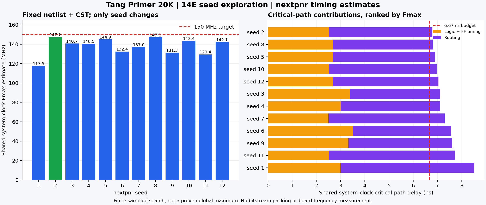

# 14E：只改变 seed，看看同一份电路能布得多快

150 MHz 的一次布局布线失败，不等于每一种布局都只能达到那次的 Fmax。本章固定输入，改变 nextpnr seed，测量布局布线选择对最终时序的影响。

## 1. 这次控制了什么？

```text
固定：同一份 Yosys 网表、同一份 ROM 初值、同一份 CST
      同一器件/封装、工具版本、算法默认值、150 MHz 目标
                               │
                       只改变 seed
              ┌────────────────┼────────────────┐
              ▼                ▼                ▼
        放置/布线 seed1   放置/布线 seed2   ... seed12
              │                │                │
              ▼                ▼                ▼
          最终时序报告      最终时序报告      最终时序报告
              └────────────────┼────────────────┘
                               ▼
               排名、关键路径、耗时、输入身份记录
```

本章没有重新综合每个 seed，也没有改 CPU 流水线、PLL 或固件。输入是第 14 章的 150 MHz 系统配置，seed 默认选择 1–12，这是本实验范围，不是工具规定。

把目标固定在 150 MHz，可以让每次优化面对相同要求；只有 seed 改变。若降低目标或替换网表，必须另做一组实验，不能混进本组排名。

## 2. seed 能改变什么，不能改变什么？

seed 影响放置/布线搜索中的选择。同样功能的单元可以占据不同位置、通过不同线路连接，从而改变路径延迟。

它不会把固定的 PLL 搬到任意 LUT，也不会把板上 LED 改焊到另一个引脚。它也不会自动加流水级，因此组合逻辑深度和可用资源仍约束结果。

Fmax 是工具对某一份实现的估计。试完 12 个 seed，得到的是**这 12 个结果中的最好值**，不是穷尽所有布局，也不是测得 FPGA 的最高物理频率。

## 3. 运行入口怎样工作？

`run.py` 做以下工作：

1. 固定输入网表和 CST，计算 SHA256，保存压缩网表和约束副本。
2. 收齐该电路的顶层、CPU、所有初始化文件和原语快照到 `rtl/`。
3. 保存工具版本、目标、器件、seed 集合和并发数量。
4. 给每个 seed 建立独立目录，运行 nextpnr。
5. 从完整路由后的 JSON 报告读所有时钟 Fmax，并提取 CPU 关键路径起终点与各类延迟。
6. 汇总最好/最差/中位数，保存最好结果的压缩 routed JSON。

默认同时运行两个进程，避免串行等待；每项 wall time 会受共享主机负载影响。并发数量是固定实验条件，耗时不能直接当作工具的普遍性能。

```bash
python chapters/14e-seed-sweep/run.py
python chapters/14e-seed-sweep/plot_results.py
```

本章会优先用 PATH 中的 nextpnr，否则使用仓库 external 的固定 OSS CAD Suite。工具版本写进 config.json。不会打包 bitstream，也不会访问板子。

## 4. 输入、输出文件之间的关系

```text
第 15 章 150 MHz 网表 + 第 14 章对应 CST/RTL
                        ↓ 冻结身份
results/14e/input/
  netlist.json.gz、tutorial14.cst、manifest.json、platform-manifest.json
                        ↓ 解压一次
  netlist.json（本地工作文件）
                        │ 每次读取完全相同内容
             ┌──────────┼──────────┐
             ▼          ▼          ▼
          seed-001/  seed-002/    ...
             │ nextpnr
             ├─ command.json：实际命令
             ├─ nextpnr.log：工具输出/最终失败原因
             ├─ pnr-report.json：最终时序与资源
             ├─ routed.json：实际放置与布线，体积较大
             └─ summary.json：本次结果、路径、耗时、退出码
                        ↓ 主机汇总
summary.json、REPORT.md、commands.json、progress.json
                        ↓
best/：最好一份布线的压缩数据、报告、身份
                        ↓ plot_results.py
seed-fmax.png / seed-fmax.svg
```

`rtl/` 保留完整 HDL 输入供读者查看/重新综合。本次实验实际读的是冻结的综合网表，不会按 HDL 再综合一次。JSON 网表已经携带综合后的存储初始化信息。

压缩文件为了避免重复提交大体积中间结果。每个 seed 的完整 routed.json 留在本地；Git 保存各项日志、报告、摘要，以及最好的一份压缩布线结果。

## 5. 如何区分目标失败和工具故障？

本实验**没有**使用 `--timing-allow-fail`。nextpnr 即使完成布线，也可以因目标不足退出码 1。

- `PASS`：所有报告时钟满足目标，工具退出 0。
- `TIMING_FAIL`：已完成路由、保存最终报告，出现目标频率违例；保留其频率用于比较，仍算目标失败。
- `TOOL_ERROR`：没有完整结果或出现其他工具错误，不能把它当一次有效频率样本。
- `TIMEOUT`：达到本章每次默认 180 秒限制，记录后保留日志；不是推断该 seed 没有合法实现。

150 MHz 的每周期预算约 6.67 ns。关键路径超过预算就失败；Fmax 较低的完整结果仍能说明这个 seed 的实现质量，但不能称为 150 MHz 可下载验收版本。

## 6. 结果怎么看？

主报告按 seed 列出 Fmax 和耗时，另给最好、最差和中位数。排名使用所有报告时钟中最低的 Fmax，避免只看 CPU 而漏掉另一时钟域；图中展示工具命名为 `VexRiscv.clk` 的共享系统域。

关键路径保存源寄存器/端口、终点、位置、逻辑和布线延迟。不同 seed 的最慢路径可能改变，不能假设只缩短同一条线。

图左侧是共享系统域 Fmax，红线是 150 MHz 输入目标；右侧按结果排名展示 共享系统域关键路径的逻辑/触发器与布线贡献，红线是周期预算。它是静态报告，没有计时测量真实板子。

结果和实际实验记录在 [results/14e](../../results/14e/REPORT.md)。运行完成后，本文下方会记录本组观察。

## 7. 如何在别的机器重放？

若已保存本章 input 快照，可用它避免依赖旧构建工作目录：

```bash
python chapters/14e-seed-sweep/run.py --replay --output results/14e \
  --seeds 1,2,3,4 --jobs 2
```

该命令会覆盖相应场景与汇总；保留历史实验时，先复制完整的 input/、rtl/ 到一个新的输出目录，再用那个目录重放。重放先核对输入哈希。工具和器件数据库版本也应一致，只有输入相同不保证跨版本位置相同。

若要扩大覆盖，用 `--seeds` 给出额外编号，并建立独立输出目录。开始下一阶段前应先看收益：是否只是换了一条关键路径？布线延迟是否仍占主导？结果离目标有多大差距？

要证明一个较高**实际工作时钟**可用，需要对应 PLL/外设参数的硬件配置、正确约束、完整构建和板上固件验证。本章 seed 搜索不代替这些步骤。摘要中的 `system_fmax_mhz` 对应报告时钟名 `VexRiscv.clk`，`limiting_fmax_mhz` 是所有报告时钟的最低估计。

## 8. 本轮实际结果（2026-10-13）

已完成 seed 1–12，均使用相同输入哈希、150 MHz 目标、seed 之外的相同工具参数，并发为 2。总墙钟约 484.91 秒，12 次都完成路由，没有超时/工具故障。

| 指标 | 本组结果 |
| --- | --- |
| 最好 | seed 2，147.21 MHz |
| 最差 | seed 1，117.47 MHz |
| 中位数 | 140.57 MHz |
| 150 MHz 通过 | 0/12 |
| 改善量 | 比 seed 1 高约 29.74 MHz，即 25.32% |
| 板上验证 / bitstream 打包 | 未执行 |



最好的 seed 2 并不是 CPU 内部逻辑独自卡住：路径从 `VexRiscv.IBusCachedPlugin_cache.lineLoader_address` 的寄存器出发，到 UART TX FIFO 内部寄存器的使能端。工具中的 `VexRiscv.clk` 指共享系统时钟网络，CPU/总线/UART 等都在这个域。

该路径总计约 6.793 ns，其中路由 4.278 ns、组合逻辑 2.249 ns，加上 clk-to-q/setup 约 0.266 ns。离 150 MHz 的 6.667 ns 预算还差约 0.126 ns；接近不等于通过。这个结果提示后续可研究跨总线/CSR/FIFO 的控制路径，而不是只盯着 CPU ALU。

seed 1 精确重现先前 117.47 MHz；这一点帮助确认输入和工具匹配。其他 seed 明显更好，但最好值仍只属于本组样本。若继续探索，应把新 seed 或算法试验单独记录，保留输入身份，并按收益决定是否值得进一步修改 RTL。


## 9. 缩小 main RAM：容量减少会让时序更好吗？

第 14 章的简单固件主要从 ROM 执行，`.data` 和 `.bss` 均为 0 字节。原来的 16 KiB main RAM 并非这个程序的最低容量要求。本轮把它缩为 **4 KiB**，保留 **1 KiB 栈**；ROM 仍为 8 KiB，额外 SRAM 仍为 4 KiB，CPU、缓存、外设和 PLL 配置保持原设置。章节默认配置保留，实验通过命令行覆盖容量。

```text
旧：ROM 8 KiB + SRAM 4 KiB + main RAM 16 KiB
新：ROM 8 KiB + SRAM 4 KiB + main RAM  4 KiB
                                  ↓
             重新生成 RTL / 编译固件 / Yosys 综合
                                  ↓
             固定新网表，150 MHz，seed 1–12
```

`main_ram` 仍是 FPGA 片内内存。缩小容量后，链接脚本的栈顶从 `0x40004000` 变为 `0x40001000`，栈底变为 `0x40000c00`。因此启动代码中的 SP 初始化和 ROM 镜像也会相应更新；这里比较的是两种容量配置的完整实现。

### 怎么复现？

在 tutorial 根目录执行（先按第 15 章设置开源工具 PATH）：

```bash
python chapters/14-fpga-platform/tang_run.py \
  --sys-clk-hz 150000000 --main-ram-size 4096 \
  --output results/14e-small-ram/platform
python chapters/15-fpga-build/run.py \
  --input results/14e-small-ram/platform/rtl \
  --output results/14e-small-ram/synthesis
python chapters/14e-seed-sweep/run.py \
  --netlist results/14e-small-ram/synthesis/netlist.json \
  --constraints results/14e-small-ram/platform/constraints/tutorial14.cst \
  --rtl results/14e-small-ram/synthesis/rtl \
  --output results/14e-small-ram/sweep \
  --seeds 1,2,3,4,5,6,7,8,9,10,11,12 --jobs 2
```

另生成同容量的 27 MHz 版本，使用已有数字 testbench 检查真实 CPU 的启动、UART、按钮和复位：

```bash
python chapters/14-fpga-platform/tang_run.py --main-ram-size 4096 \
  --output results/14e-small-ram/functional
python chapters/14-fpga-platform/sim_tang.py \
  --input results/14e-small-ram/functional
```

这项功能仿真使用 27 MHz 理想 PLL 模型；150 MHz 的静态时序由另一份对应 PLL/外设参数的网表检查。完整 RTL、链接映射、综合日志及每个 seed 的时序证据保存到 [缩小 RAM 实验](../../results/14e-small-ram/README.md)。

### 本轮结果（2026-10-14）

已完成全部 12 个 seed，150 MHz 通过 **0/12**。4 KiB 配置最佳为 **seed 8，142.35 MHz**，中位数 131.62 MHz；16 KiB 配置最佳为 147.21 MHz。块 RAM 原语从 24 个降到 18 个，但本组最佳频率下降约 4.86 MHz。27 MHz 同容量数字功能仿真通过。

最佳关键路径现在是 CPU 数据侧异常码寄存器到指令缓存 tag RAM 地址端，总延迟约 7.025 ns，超出 150 MHz 的 6.667 ns 预算。main RAM 变小节省了存储资源，但没有消除这个 CPU 控制路径；后续提频应依据关键路径修改，而不能仅靠减少 RAM。详细对比和证据见 [实验记录](../../results/14e-small-ram/README.md)。


## 10. 换布局布线算法：在同一份电路上尝试不同解法

这次回到原来的 **16 KiB main RAM / 150 MHz** 网表。容量不再变化，重新运行默认参数作为对照，避免把前一组缩小 RAM 的结果混进比较。我们希望观察：关键路径中较大的布线延迟，能否通过改变算法和权重缩短？

```text
同一份综合后网表 + 同一份 CST + 同一器件 + 150 MHz
                           │
            每组使用 seed 2、5、8
                           │
        ┌──────────────────┼───────────────────┐
        ▼                  ▼                   ▼
   改布局算法         改布线算法          改优化权重
  heap/static/sa     router1/router2     timingweight/critexp
        └──────────────────┼───────────────────┘
                           ▼
                  最终路由后的时序报告
```

### 实验组为什么这样选？

| 名称 | 相对默认设置的变化 | 想观察什么 |
| --- | --- | --- |
| heap-default | 无；重新运行相同 seed | 确认对照能重现 |
| heap-router1 | 显式选择 router1 | 另一布线路径搜索策略 |
| heap-router2 | 显式选择 router2 | 另一布线路径搜索策略 |
| heap-weight20 | heap 时序权重 10→20 | 更强调时序是否改善结果 |
| heap-crit3 | heap 关键度指数 2→3 | 改变关键连接的权重分配 |
| heap-router2-ripup | router2 + tmg-ripup | 时序驱动的拆线重布是否有效 |
| heap-router2-alt | router2 + alternate weights | 改变 router2 的内部权重 |
| static-router2 | static 布局 + router2 | 换布局算法的结果 |
| sa-router2 | sa 布局 + router2 | 模拟退火布局的结果 |

比较 router2-ripup/alt 时应以 heap-router2 为对照；比较 static/sa 时也以 heap-router2 为对照。这样能分清布局和布线的变化来源。`default` 是工具的默认路由选择，不预先假定它必定等于某个显式 router。

权重 20、指数 3、seed 集合和 600 秒超时都是本次实验选择，不是普遍最优设置。更高权重也可能让拥塞增加。FPGA 的行列、RAM/PLL 位置由芯片固定，这些参数只改变已有资源上的分配和连接。

### 怎么运行，证据在哪里？

```bash
python chapters/14e-seed-sweep/algorithm_sweep.py
```

默认运行全部 9 组，每组 3 个 seed；两个实验组并行，每组两个 nextpnr 进程，最多同时四项。超时限制为每项 600 秒。共享主机负载影响耗时，不能把不同项的墙钟时间直接当作算法速度排名。

入口调用同一章的 `run.py`。它支持 `--placer`、`--router`、`--timingweight`、`--critexp`、`--beta`、`--tmg-ripup` 和 `--router2-alt-weights`；每组参数写入 config.json 和实际 command.json。每组内部只改变 seed。

结果位于 [results/14e-algorithms](../../results/14e-algorithms/README.md)：根目录给出跨组配置、进度、汇总；每个组都有冻结输入、完整 RTL、逐项日志/时序报告，以及该组最佳布线的压缩快照。没有完整时序的超时或工具错误保留证据，但不计入 Fmax 排名。没有使用 timing-allow-fail，也不下载到板子。


### 通用帮助里列出的算法，都能在 Gowin 上用吗？

不能只看 `--help` 的通用列表。算法是否能运行，还取决于所选 FPGA 后端和当前版本。

本次 nextpnr `0.11.1-54-g861c57be` 的实际结果：

- `static`：Gowin 后端明确拒绝，日志为 `This uarch does not support the 'static' placer.`，三个 seed 都没有时序结果。
- `sa`：本设计在初始布局阶段收到 SIGSEGV（退出码 -11），三个 seed 都没有时序结果。不能据此判断 sa 的频率高低。
- router2 的 `tmg-ripup`：seed 2 触发 `base_arch.h:259` 的断言；其他 seed 完成路由但仍未达到 150 MHz。

失败日志保留在对应组目录。这些不是靠延长等待就能自动解决的时序不足；在本轮比较中记为工具故障，并使用能够完成的 heap 配置继续实验。

router1 和 router2 的完成日志不同：router1 打印 `Routing complete.`；router2 打印迭代的资源冲突数量及 `Router2 time`。解析入口同时检查最终资源冲突为零、完整路由/时序文件和退出信息，避免把 router2 的完整结果误判为工具错误。`--analyze-existing` 可重新解析已有证据，不会重新运行 nextpnr。


### 看到候选改善后，怎么继续？

第一轮权重 20 / seed 2 达到约 149.45 MHz，比对照的 147.21 MHz 提高。随后增加四组（仍使用 seed 2、5、8）：权重 30、权重 40、权重 20 + 密度 0.8、权重 20 + 关键度指数 3。

```bash
python chapters/14e-seed-sweep/algorithm_sweep.py \
  --output results/14e-algorithms/followup \
  --profiles heap-weight30,heap-weight40,heap-weight20-beta80,heap-weight20-crit3
```

进一步把有改善的权重 20 扩展到 seed 1–12。2、5、8 已有完整结果，新增其余 9 个，不重复运行：

```bash
python chapters/14e-seed-sweep/run.py \
  --output results/14e-algorithms/weight20-extra-seeds \
  --seeds 1,3,4,6,7,9,10,11,12 --timingweight 20 --jobs 2 --timeout 600
```

本轮最终合计 48 次实际布局布线尝试。通用算法组按共同的 3 个 seed 比较；权重 20 的 12 个 seed 另与旧默认配置的 12 个 seed 比较，避免将不同样本数的中位数直接混用。完整过程和结果写在 [算法实验记录](../../results/14e-algorithms/README.md)。


### 本轮最终结果（2026-10-14）

完成 **48 次实际尝试**：13 组配置各 3 个共同 seed，加上权重 20 新增的 9 个 seed。其中 41 次产生完整时序结果，7 次工具错误，没有超时。只有 **权重 20、seed 3** 满足 150 MHz，最佳 Fmax 为 **150.49 MHz**。

| 相同 seed 1–12 的指标 | 默认权重 10 | 权重 20 |
| --- | ---: | ---: |
| 最佳 Fmax | 147.21 MHz | 150.49 MHz |
| 中位数 | 140.57 MHz | 141.72 MHz |
| 150 MHz 通过 | 0/12 | 1/12 |

见到改善的配置是 **heap 布局 + timingweight=20 + 默认路由**。最好值增加约 3.28 MHz（2.23%）；中位数也略有提高，但部分 seed 退步了。当前版本中，换 router2、调整其他权重/密度并没有超过这项结果，static/sa 遇到后端支持或工具错误。

最佳路径从 CPU memory 阶段的异常有效寄存器，到指令缓存 tag RAM 地址端；总延迟约 **6.645 ns**，其中布线 3.646 ns、逻辑 2.734 ns，clk-to-q/setup 合计 0.265 ns。相比 150 MHz 的 6.667 ns 预算，余量仅约 **0.022 ns**。它通过了本工具版本的静态检查，板上运行尚未验证，章节默认配置保留。


最佳完整布线/时序快照位于 `results/14e-algorithms/best/`。实验根目录的 `campaign-summary.json` 是跨阶段完整结果；`summary.json` 保留最初九组结果。详细表格、工具故障、输入身份和文件关系见 [完整记录](../../results/14e-algorithms/README.md)。

完成实验后可重新生成汇总和图片：

```bash
python chapters/14e-seed-sweep/summarize_algorithms.py
python chapters/14e-seed-sweep/plot_algorithms.py \
  --input results/14e-algorithms/campaign-summary.json
```


## 11. 在 GUI 中查看最佳实现

当前 WSLg 与独立修复版 GUI 已验证可启动并加载快照。原 SDK 在恢复 Gowin 快照时触发缓存越界，因此查看入口使用独立版本。首次构建后即可查看 150.49 MHz 最佳快照：

```bash
python chapters/14e-seed-sweep/build_gui_viewer.py
python chapters/14e-seed-sweep/view_gui.py
```

脚本核对压缩快照的 SHA256、准备解压 JSON，并打开 nextpnr GUI；直接加载已有位置和路由，不重新跑综合/布局/布线。交互步骤与 GUI/科学绘图的区别见 [第 14 章 GUI 说明](../14-fpga-platform/README.md#用-nextpnr-gui-交互查看布局布线)。


恢复检查可单独重放：

```bash
python chapters/14e-seed-sweep/verify_gui_restore.py
```

它使用真实 nextpnr 上下文读取/导出快照，比较所有单元位置和非空网络的路由三元组，不重新运行布局布线。日志和结果位于 [results/14e-gui](../../results/14e-gui/README.md)。
